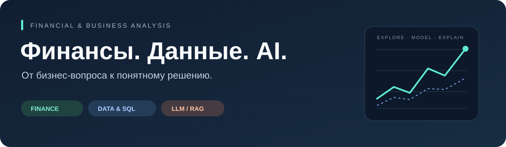

  

  <a href="#user-content-обо-мне">Обо мне</a> ·
  <a href="#user-content-проекты">Проекты</a> ·
  <a href="#user-content-навыки-и-инструменты">Навыки</a> ·
  <a href="https://github.com/Krevetka2077?tab=repositories">Все репозитории</a>

## Обо мне

Финансовый и бизнес-аналитик начального уровня с практическим опытом в банковских операциях и корпоративных финансах. Работал с финансовой отчётностью, материалами по корпоративному кредитованию, казначейскими и брокерскими процессами.

Соединяю финансовый контекст с техническими инструментами: использую **Python и SQL** для работы с данными, моделирую бизнес-процессы и структурирую требования. Отдельное направление — **LLM и RAG**: поиск по документам, работа с embeddings и интеграция языковых моделей в прикладные системы.

На GitHub собираю аналитические инструменты и прототипы цифровых продуктов. Интересуют задачи, в которых расчёты помогают разобраться в рисках, сравнить сценарии и обосновать решение.

## Проекты

<table>
<tr>
<td width="50%" valign="top">

### 📊 Bond

**Анализ и оптимизация инвестиционного портфеля**

Локальное приложение: пользователь загружает историю цен, задаёт текущие доли и ограничения по активам. Приложение сравнивает текущий портфель с вариантами минимального риска и максимального отношения доходности к риску.

- Историческая доходность и волатильность.
- VaR, CVaR и максимальная просадка.
- Оптимизация долей и экспорт результата в CSV.

`Python` `Streamlit` `Riskfolio-Lib` `pandas`

[Открыть проект →](https://github.com/Krevetka2077/Bond)

</td>
<td width="50%" valign="top">

### 🛰️ FIN_Drone

**Концепция платформы для беспилотных систем**

Учебный проект IT-агрегатора: продуктовая концепция, архитектура платформы и план реализации. Репозиторий объединяет описание решения, финансовые материалы и прототипы интерфейсов.

- Модульная структура цифрового продукта.
- Архитектура и сценарии интеграции.
- План запуска и экономическая модель.

`Business analysis` `Architecture` `HTML` `Finance`

[Открыть проект →](https://github.com/Krevetka2077/FIN_Drone)

</td>
</tr>
</table>

## Навыки и инструменты

| Направление | Задачи и инструменты |
| :--- | :--- |
| **Финансы и риски** | Финансовая отчётность, денежные потоки, анализ заёмщика, бюджетирование, NPV / IRR, инвестиционные инструменты |
| **Данные и аналитика** | Python, SQL, PostgreSQL, SQL Server, Excel; подготовка данных и аналитические расчёты |
| **Бизнес- и IT-анализ** | Сбор требований, моделирование процессов, BPMN, UML, IDEF0, проектирование информационных систем |
| **AI и поиск по знаниям** | LLM, prompt engineering, RAG, embeddings, semantic search, vector databases, API-интеграции |
| **Разработка и прототипы** | Git, Docker; Streamlit и Riskfolio-Lib в проекте Bond |

## Подход к аналитической задаче

Сначала определить задачу и ограничения, затем проверить данные и допущения. Результат анализа должен быть понятен человеку, который будет на его основе принимать решение.

---

  <b>Финансовый контекст + работа с данными + понятный результат</b> 
  <a href="https://github.com/Krevetka2077?tab=repositories">Посмотреть репозитории</a>

